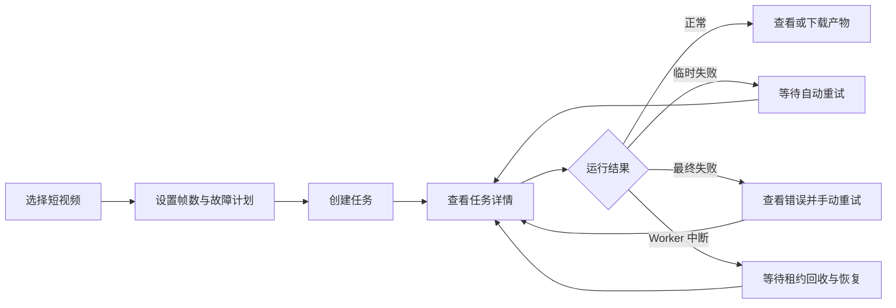

# 需求规格

## 1. 问题定义

耗时 AI 任务通常由多个有依赖关系的步骤组成。单个步骤可能报错、超时，执行进程可能退出，任务也可能在相同输入上重复运行。系统需要让操作员知道任务正在做什么、哪里失败、能否恢复，并避免重复计算已成功且仍然有效的结果。

本项目实现一个单机、可持久化的任务管线 MVP，用动画视频素材处理作为示例场景。

## 2. 目标

| 编号 | 目标 | 成功标准 |
|---|---|---|
| G-01 | 可观测 | 页面能够查看任务和步骤的状态、进度、耗时、日志与执行次数 |
| G-02 | 可恢复 | Worker 异常退出后，系统能识别失联步骤并继续执行 |
| G-03 | 可重试 | 临时失败按策略自动重试，永久失败不会无限重试 |
| G-04 | 可复用 | 相同输入、参数和步骤版本可以复用有效产物 |
| G-05 | 可验证 | 正常、失败、中断和缓存命中均有自动化测试与固定演示路径 |

## 3. 非目标

- 不训练或部署真实大模型。
- 不实现 Kubernetes、跨机器调度或高可用集群。
- 不实现登录、计费、权限和多租户。
- 不支持任意 DAG 编辑器；MVP 使用固定五步管线。
- 不追求高吞吐视频处理或专业剪辑效果。
- 不把日志系统、对象存储或消息队列外部化。

## 4. 用户角色

### 操作员

创建任务、查看进度、定位失败、重试失败步骤、重新运行任务、查看产物。

### 评审者

使用故障注入验证恢复能力，检查状态历史、缓存复用和自动测试结果。

### Worker

领取可运行步骤、更新心跳和进度、写入产物、记录成功或失败。

## 5. MVP 任务定义

| 顺序 | 步骤键 | 行为 | 主要输出 | 默认重试 |
|---:|---|---|---|---:|
| 1 | `validate_input` | 检查格式、大小、时长并计算 SHA-256 | `input_metadata.json` | 0 |
| 2 | `extract_frames` | 均匀提取 8 张 JPEG 关键帧 | `frames/*.jpg` | 1 |
| 3 | `analyze_frames` | Mock GPU/AI 分析，逐帧生成标签和分数 | `analysis.json` | 2 |
| 4 | `build_contact_sheet` | 将关键帧和分析摘要绘制成预览图 | `contact-sheet.jpg` | 1 |
| 5 | `package_result` | 汇总产物、日志摘要和执行信息 | `result.zip` | 1 |

步骤 3 默认每张帧等待少量时间，用于模拟耗时推理、持续进度和 GPU 资源占用。

## 6. 输入约束

- 支持 `.mp4` 和 `.mov`。
- 单文件不超过 50 MB。
- 视频时长不超过 20 秒。
- 至少能够成功读取一帧。
- 参数使用 JSON，MVP 包含 `frame_count`、`analysis_profile` 和 `fault_plan`。
- `frame_count` 默认 8，范围 4-12。

输入不符合约束属于永久失败，不自动重试。

## 7. 功能需求

| 编号 | 需求 |
|---|---|
| FR-01 | 用户可以上传视频并创建任务，重复的幂等键返回原任务 |
| FR-02 | 系统创建固定五步任务，并记录步骤依赖关系 |
| FR-03 | Worker 只能领取前置步骤已成功或缓存命中的步骤 |
| FR-04 | 页面展示任务总状态、总进度和所有步骤状态 |
| FR-05 | 页面展示每一步的尝试次数、耗时、最后心跳、日志和错误 |
| FR-06 | 临时失败按照退避策略自动重试，达到上限后停止 |
| FR-07 | 用户可以手动重试失败步骤，成功前置步骤不得重复执行 |
| FR-08 | Worker 中断后，超时租约由恢复扫描器回收 |
| FR-09 | 相同缓存键且校验通过的产物可以直接复用 |
| FR-10 | 缓存文件缺失或校验失败时必须重新计算 |
| FR-11 | 用户可以重新运行整项任务，并选择允许或忽略缓存 |
| FR-12 | 测试模式可以指定步骤在特定进度失败、超时或终止 Worker |
| FR-13 | 用户可以查看并下载最终产物和中间产物 |
| FR-14 | 状态变更写入只追加事件记录，支持查看完整时间线 |
| FR-15 | Mock GPU 步骤同时只允许一个实例运行 |

## 8. 非功能需求

| 编号 | 需求 | 指标 |
|---|---|---|
| NFR-01 | 数据持久性 | API 或 Worker 重启后任务状态不丢失 |
| NFR-02 | 恢复时延 | Worker 失联后 20 秒内把步骤恢复为可执行状态 |
| NFR-03 | 状态一致性 | 同一步骤同一时刻最多有一个有效执行租约 |
| NFR-04 | 可解释性 | 所有失败显示错误类型、摘要和对应 attempt |
| NFR-05 | 本地安全 | 所有产物路径必须位于 `.runtime` 根目录内 |
| NFR-06 | 空间控制 | 单任务默认产物不超过 200 MB，临时文件成功后回收 |
| NFR-07 | 可测试性 | 核心状态机、租约和缓存逻辑不依赖真实时间或真实 AI |
| NFR-08 | 可启动性 | Windows 环境使用一条命令分别启动 API 和 Worker |

## 9. 用户流程

## 10. 边界条件

- API 重启不会修改正在运行步骤的租约；Worker 仍可完成并提交结果。
- Worker 重启后不能相信进程内队列，只能从数据库重新领取步骤。
- 一个 attempt 成功提交后，旧 Worker 的迟到提交必须被租约令牌拒绝。
- 步骤输出先写临时目录，全部成功后再原子移动到正式产物目录。
- 用户手动重试只允许作用于 `FAILED` 步骤。
- 下游步骤已经运行时，不允许直接重试其上游步骤；应创建一次 rerun。

## 11. 完成定义

阶段二至阶段四全部完成时，项目必须满足：

1. 全新环境可按 README 启动。
2. 五步正常任务可以端到端成功。
3. 四类故障演示可以重复执行并得到预期状态。
4. 自动测试验证状态机、租约、重试、缓存和并发领取。
5. 页面能让评审者不看数据库就理解任务发生了什么。
6. 文档如实记录限制、AI coding 工具、Token 与人工耗时。
