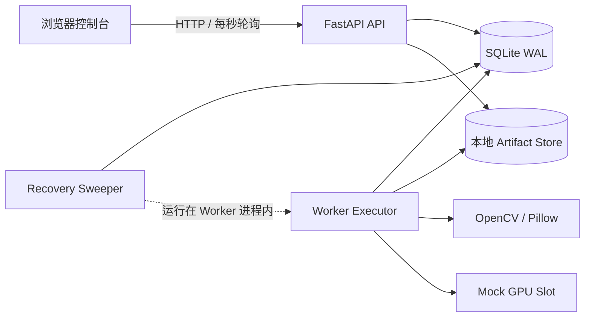
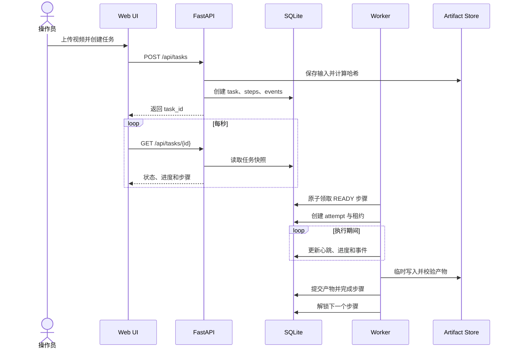
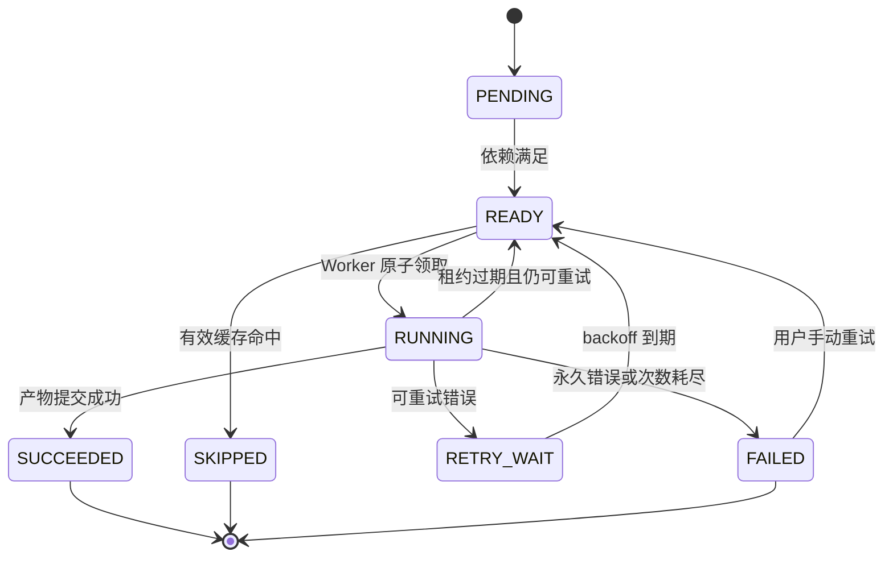
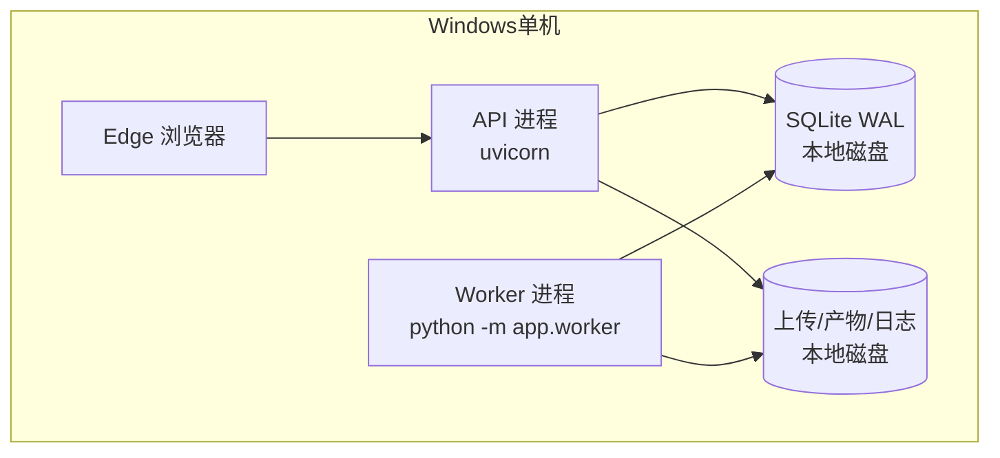

# 系统架构

## 1. 架构结论

MVP 使用两个长期运行进程：API 负责请求和查询，Worker 负责步骤执行与恢复扫描。SQLite 是任务状态的唯一事实来源，文件系统保存视频和步骤产物。浏览器每秒轮询任务详情，减少实时通信层带来的额外复杂度。

## 2. 组件关系



### 浏览器控制台

- 创建任务。
- 查看任务列表和任务详情。
- 展示步骤时间线、日志、错误、尝试历史和产物。
- 发起重试、恢复和 rerun。
- 在测试模式选择故障注入方案。

### FastAPI API

- 校验请求并保存上传文件。
- 创建任务、步骤和依赖。
- 返回数据库中的持久化状态。
- 接收手动重试与 rerun 命令。
- 不直接运行视频处理步骤。

### Worker Executor

- 使用数据库事务原子领取 `READY` 步骤。
- 创建 attempt 和租约令牌。
- 更新心跳、进度与事件。
- 调用步骤实现并提交产物。
- 根据错误类型决定重试或最终失败。

### Recovery Sweeper

- 每 5 秒检查过期租约。
- 把对应 attempt 标记为 `LOST`。
- 在剩余尝试次数允许时，把步骤放回 `READY`。
- 超出尝试上限时将步骤标记为 `FAILED`。

### Artifact Store

所有文件均限制在项目运行目录：

```text
<PROJECT_ROOT>\.runtime
```

建议布局：

```text
.runtime/
├─ uploads/{task_id}/source.mp4
├─ staging/{attempt_id}/
├─ artifacts/{cache_key}/
├─ logs/{task_id}/{step_key}/{attempt_no}.log
├─ app.db
└─ temp/
```

## 3. 任务执行流程



## 4. 步骤状态机



`RUNNING -> READY` 时不会覆盖旧 attempt；旧 attempt 被记为 `LOST`，新执行创建新的 attempt。

## 5. 任务状态推导

任务状态尽量从步骤状态推导，避免两套事实互相矛盾：

| 条件 | 任务状态 |
|---|---|
| 尚无步骤开始 | `PENDING` |
| 任一步骤为 `RUNNING`、`READY` 或 `RETRY_WAIT` | `RUNNING` |
| 所有步骤为 `SUCCEEDED` 或 `SKIPPED` | `SUCCEEDED` |
| 存在最终 `FAILED` 且没有可继续步骤 | `FAILED` |
| 用户主动暂停且没有运行中步骤 | `PAUSED` |

任务进度使用步骤权重计算：

```text
validate_input       5%
extract_frames      20%
analyze_frames      45%
build_contact_sheet 20%
package_result      10%
```

## 6. 租约和心跳

- Worker 领取步骤时生成不可预测的 `lease_token`。
- `lease_expires_at` 默认是当前时间加 15 秒。
- Worker 每 5 秒更新一次心跳并延长租约。
- 所有进度、成功和失败提交都必须携带当前 `lease_token`。
- 令牌不匹配表示旧 Worker 的迟到提交，数据库拒绝更新。
- Recovery Sweeper 每 5 秒扫描过期租约，最坏恢复时间约 20 秒。

## 7. 幂等与缓存

缓存键定义：

```text
SHA256(
  step_key
  + step_version
  + canonical_json(parameters)
  + sorted(input_artifact_sha256)
)
```

缓存命中必须同时满足：

1. 数据库存在 `SUCCEEDED` artifact。
2. 文件仍存在于 Artifact Store。
3. 文件大小与记录一致。
4. SHA-256 校验一致。
5. 步骤版本未变化。

缓存命中后步骤进入 `SKIPPED`，并创建一条 `cache_hit` 事件。缓存损坏则记录 `cache_invalidated` 并重新执行。

## 8. 产物提交

步骤不能直接向正式目录边算边写：

1. 在 `staging/{attempt_id}` 写入全部输出。
2. 校验输出文件存在、可读取并计算 SHA-256。
3. 使用同卷原子移动进入 `artifacts/{cache_key}`。
4. 在同一数据库事务中创建 artifact 记录并完成步骤。
5. 失败或租约失效时清理 staging，不污染正式缓存。

## 9. Mock GPU 资源

`analyze_frames` 在执行前申请名为 `gpu:0` 的资源租约。MVP 只有一个槽位，因此两个 AI 步骤不能并行。资源租约同样包含 owner、token、heartbeat 和过期时间；Worker 异常退出后可以自动回收。

这不是 GPU 集群调度器，但能够解释真实系统如何扩展到多 GPU、显存容量和优先级调度。

## 10. 部署拓扑



阶段一不引入 Redis、Celery 或 Docker。未来需要多机器扩展时，可以把 SQLite 替换为 PostgreSQL，把本地 Artifact Store 替换为对象存储，并把 Worker 的领取协议迁移到成熟工作流系统。
