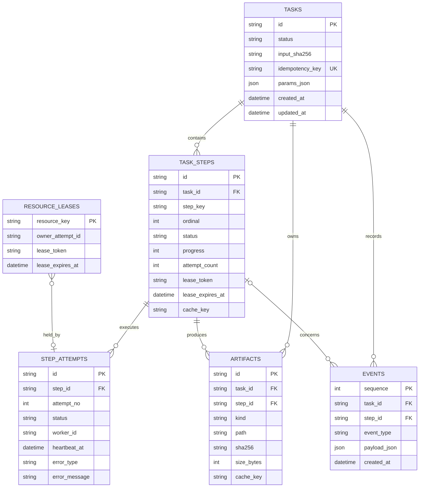

# 数据模型与 API

## 1. 数据关系



## 2. 表职责

### `tasks`

保存任务身份、输入哈希、参数、显示状态和时间。`idempotency_key` 唯一，防止重复点击创建相同任务。

### `task_steps`

保存当前步骤快照。`UNIQUE(task_id, step_key)`，`progress` 范围 0-100。领取步骤时必须使用条件更新保证原子性。

### `step_attempts`

保存每次执行历史，不覆盖旧记录。状态包括 `RUNNING`、`SUCCEEDED`、`FAILED`、`LOST` 和 `TIMED_OUT`。

### `artifacts`

保存产物元数据，不把大文件写进数据库。`path` 使用相对于 `.runtime` 的路径，API 拼接前再次执行路径边界检查。

### `events`

只追加的事件流。事件示例：`task_created`、`step_claimed`、`progress_changed`、`retry_scheduled`、`lease_expired`、`cache_hit`、`artifact_committed`。

### `resource_leases`

保存 Mock GPU 等排他资源。资源租约过期后可由恢复扫描器回收。

## 3. 数据库约束

- 启用 `PRAGMA journal_mode=WAL`。
- 启用 `PRAGMA foreign_keys=ON`。
- 时间统一保存为 UTC ISO-8601。
- 所有枚举值由应用层和数据库 `CHECK` 双重限制。
- 领取步骤、创建 attempt 和写入事件在同一事务中完成。
- 完成步骤、提交 artifacts 和解锁下游步骤在同一事务中完成。
- 事件 `sequence` 单调递增，可用于前端增量读取。

## 4. 核心 API

| 方法 | 路径 | 用途 |
|---|---|---|
| `POST` | `/api/tasks` | 上传视频并创建任务 |
| `GET` | `/api/tasks` | 分页查询任务列表 |
| `GET` | `/api/tasks/{task_id}` | 获取任务、步骤和 attempts 快照 |
| `GET` | `/api/tasks/{task_id}/events` | 按 sequence 增量读取事件 |
| `POST` | `/api/tasks/{task_id}/resume` | 恢复处于 `PAUSED` 的任务 |
| `POST` | `/api/tasks/{task_id}/rerun` | 创建新的任务执行，可选择忽略缓存 |
| `POST` | `/api/tasks/{task_id}/steps/{step_key}/retry` | 手动重试最终失败步骤 |
| `GET` | `/api/artifacts/{artifact_id}` | 下载或查看产物 |
| `POST` | `/api/debug/fault-plans` | 测试模式创建故障计划 |
| `GET` | `/api/health` | API、数据库和 Artifact Store 健康状态 |

## 5. 创建任务请求

使用 `multipart/form-data`：

```text
file: demo.mp4
frame_count: 8
analysis_profile: default
fault_plan: analyze_fail_once_at_50
idempotency_key: client-generated-uuid
```

成功响应：

```json
{
  "task_id": "tsk_01J...",
  "status": "PENDING",
  "created": true,
  "links": {
    "self": "/api/tasks/tsk_01J..."
  }
}
```

相同 `idempotency_key` 再次提交时返回原 `task_id`，`created` 为 `false`。

## 6. 任务详情响应

```json
{
  "id": "tsk_01J...",
  "status": "RUNNING",
  "progress": 43,
  "created_at": "2026-10-07T08:00:00Z",
  "steps": [
    {
      "key": "analyze_frames",
      "status": "RUNNING",
      "progress": 40,
      "attempt_count": 2,
      "max_attempts": 3,
      "last_heartbeat_at": "2026-10-07T08:01:15Z",
      "last_error": null
    }
  ],
  "artifacts": []
}
```

## 7. 手动重试语义

请求：

```http
POST /api/tasks/{task_id}/steps/{step_key}/retry
Idempotency-Key: retry-request-uuid
```

服务端校验：

1. 步骤必须是最终 `FAILED`。
2. 不存在运行中的下游步骤。
3. 同一重试请求不能重复生效。
4. 保留旧 attempts 和错误记录。
5. 清空当前 lease，增加手动重试配额并置为 `READY`。

## 8. 错误格式

所有 API 错误使用统一结构：

```json
{
  "error": {
    "code": "STEP_NOT_RETRYABLE",
    "message": "该步骤当前不能重试",
    "details": {
      "step_status": "RUNNING"
    },
    "request_id": "req_01J..."
  }
}
```

错误消息可以面向用户展示，堆栈信息只写入 attempt 日志，不直接返回浏览器。

## 9. 前端轮询策略

- 任务运行时每秒请求一次任务详情。
- 任务进入终态后停止轮询。
- 日志与事件使用 `after_sequence` 增量读取。
- 网络错误采用 1、2、4、8 秒退避，页面保留最后成功快照。
- 浏览器刷新后根据 URL 中的 `task_id` 恢复页面，不依赖前端内存。
