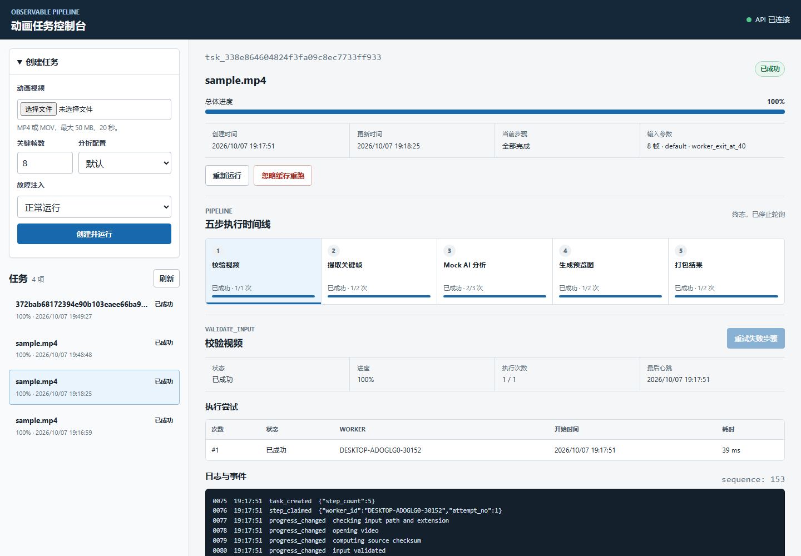
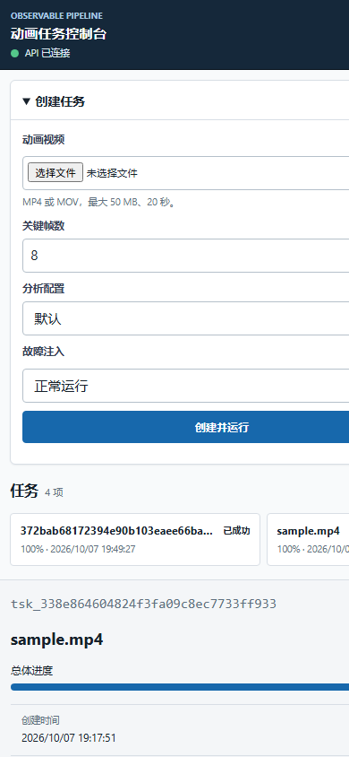

# 阶段三验收与需求追踪

## 1. 文档用途

本文把原始测试题要求逐项映射到当前实现、查询入口和自动化测试，并给出四个必须能够重复演示的场景。它既是面试官的验收索引，也是第一次运行项目的操作说明。

验收时以三类证据为准：

1. **持久化证据**：任务、步骤、attempt、事件和产物记录保存在 SQLite 与 `.runtime` 中。
2. **可见证据**：浏览器控制台或 API 能显示状态变化、错误、心跳、重试历史与产物。
3. **自动化证据**：测试直接断言状态、attempt 顺序、缓存命中、租约恢复和并发约束。

## 2. 原题要求追踪

| 原题要求 | 当前实现 | 主要文件 | 验证证据 | 结论 |
|---|---|---|---|---|
| 设计一个可观测的 AI 任务执行管线 MVP | API、独立 Worker、SQLite WAL、Artifact Store 和浏览器控制台组成单机 MVP | `app/api/main.py`、`app/worker/runner.py`、`app/db/`、`app/static/` | `tests/integration/test_api_worker_flow.py` | 已实现 |
| 以动画素材处理为例，包含多个连续步骤 | 固定五步：输入校验、抽帧、Mock AI 分析、预览拼图、结果打包 | `app/pipeline/registry.py`、`app/pipeline/steps.py` | `test_registry_has_fixed_order_weights_versions_and_retries`、`test_five_steps_execute_end_to_end_with_small_video` | 已实现 |
| 单个步骤失败后能够合理恢复并继续 | 可重试错误进入 `RETRY_WAIT`，退避到期后重新领取；永久失败支持人工重试 | `app/db/repository.py`、`app/worker/runner.py` | `test_retryable_analysis_failure_resumes_without_repeating_prior_steps`、`test_manual_retry_resumes_a_non_retryable_step` | 已实现 |
| 执行进程中断后能够恢复 | Worker 使用心跳、15 秒租约和 fencing token；恢复扫描把过期 attempt 标为 `LOST` 并重新执行 | `app/db/repository.py`、`app/worker/runner.py` | `test_expired_lease_is_recovered_and_old_fencing_token_is_rejected`；真实中断演示记录见 `docs/05-implementation-notes.md` | 已实现 |
| 长时间任务执行期间可观察 | Worker 持续写入进度、心跳、事件和 attempt；页面轮询持久化快照 | `app/db/models.py`、`app/db/repository.py`、`app/static/app.js` | `test_step_heartbeat_extends_owned_resource_lease`、UI 契约测试 | 已实现 |
| 上层能够查看任务及步骤状态 | 提供任务列表、任务详情、事件增量查询和产物下载接口；页面展示五步时间线 | `app/api/main.py`、`app/api/schemas.py`、`app/static/` | `test_task_detail_serializes_nested_pipeline_state`、`test_console_exposes_required_dom_regions` | 已实现 |
| 重点体现任务状态与执行历史 | `tasks` 保存任务快照，`task_steps` 保存步骤快照，`step_attempts` 保留每次执行，`events` 只追加 | `app/db/models.py`、`app/domain/state_machine.py` | `tests/unit/domain/test_state_machine.py`、`tests/integration/db/test_repository.py` | 已实现 |
| 重点体现失败恢复 | 区分永久输入错误、可重试错误、超时、租约丢失、产物校验失败和非法状态 | `app/domain/errors.py`、`app/pipeline/faults.py`、`app/db/repository.py` | 自动重试、人工重试、过期租约和损坏缓存测试 | 已实现 |
| 重点体现结果复用 | 缓存键包含步骤、版本、规范化参数与输入哈希；命中后步骤进入 `SKIPPED` | `app/pipeline/artifacts.py`、`app/worker/runner.py` | `test_api_worker_pipeline_and_cache_rerun`、`test_cache_hit_copies_metadata_finishes_attempt_and_unlocks_next_step` | 已实现 |
| 缓存损坏时不能返回错误结果 | 命中前校验路径、大小与 SHA-256；无效目录移入 `quarantine` 后重新计算 | `app/pipeline/artifacts.py`、`app/worker/runner.py` | `test_commit_is_atomic_and_cache_damage_is_detected`、`test_damaged_cache_can_be_quarantined_before_recompute` | 已实现 |
| 不要求真实大模型，可 Mock 实际耗时过程 | 分析步骤使用确定性 Mock AI，逐帧更新进度，并支持失败、超时和退出注入 | `app/pipeline/steps.py`、`app/pipeline/faults.py` | `tests/unit/pipeline/test_steps.py` | 已实现 |
| 不要求完整分布式调度系统 | 采用单机双进程；数据库是唯一状态来源，API 不执行视频步骤 | `docs/02-architecture.md`、`app/api/main.py`、`app/worker/runner.py` | API/Worker 端到端测试 | 符合范围 |
| 步骤级重试、恢复和结果复用 | 自动重试、人工重试、租约回收、rerun 和缓存命中都有独立状态与事件 | `app/db/repository.py`、`app/api/main.py` | `test_due_retry_is_claimable_in_the_same_poll`、人工重试和缓存端到端测试 | 已实现 |
| 提供可视化或查询接口 | 浏览器控制台之外，所有关键状态均可通过 REST API 查询 | `app/static/`、`app/api/main.py` | 11 项 UI 契约测试及 API 集成测试 | 已实现 |
| 考虑从秒级扩展到小时级 | 使用持久化状态、可续租心跳、有限重试、断点边界、幂等提交与缓存；扩展讨论见架构文档 | `docs/02-architecture.md`、`docs/04-recovery-and-acceptance.md` | 设计审查 | 已说明 |
| 分析哪些 AI pipeline 步骤适合独立恢复 | 每一步有明确输入、产物和确定性边界；成功前置步骤不因下游失败而重算 | `docs/01-requirements.md`、`app/pipeline/registry.py` | 自动重试测试断言前两步 attempt 数保持为 1 | 已说明并实现 |
| 考虑 GPU 资源调度与可观察性 | `analyze_frames` 领取单槽 `gpu:0` 资源租约，步骤心跳同时续租 | `app/db/models.py`、`app/db/repository.py`、`app/worker/runner.py` | `test_step_heartbeat_extends_owned_resource_lease` | 已实现 Mock 方案 |
| 防止并发重复执行和旧 Worker 覆盖新结果 | 原子领取保证一个有效 claim；每次提交校验 lease token | `app/db/repository.py` | `test_two_claimers_cannot_claim_the_same_step`、`test_expired_lease_is_recovered_and_old_fencing_token_is_rejected` | 已实现 |
| 提供 Markdown 说明、失败案例和可复现方法 | README、架构、数据/API、恢复验收、实现记录及本文形成完整文档链 | `README.md`、`docs/01` 至 `docs/07` | 人工审阅 | 已实现 |

## 3. 为什么把五步拆成独立恢复单元

| 步骤 | 适合独立恢复的原因 | 失败后应保留什么 |
|---|---|---|
| `validate_input` | 输入与规则确定，输出元数据可复用；非法输入属于永久错误 | 原视频、校验错误和 attempt |
| `extract_frames` | 通常比校验耗时，结果由视频哈希和帧数决定 | 已校验输入、成功抽取的正式缓存 |
| `analyze_frames` | 最耗时且可能占 GPU，最容易遇到服务抖动或 Worker 中断 | 输入帧、旧 attempt、最后心跳和错误 |
| `build_contact_sheet` | 依赖帧与分析结果，但不应迫使 AI 步骤重跑 | 所有上游正式产物 |
| `package_result` | 汇总输出，失败只需重新打包 | 上游图片、JSON、manifest 和历史 |

独立恢复的前提是步骤输出先写 `staging/{attempt_id}`，校验完成后再原子提交。这样失败 attempt 的半成品不会被下游误认为有效缓存。

## 4. 四个必须演示的场景

API 和一个普通 Worker 启动后，可以逐项操作页面，也可以运行统一验收脚本：

```powershell
.\.venv\Scripts\python.exe scripts\demo_acceptance.py all
```

脚本依次执行正常运行、自动重试、缓存复用和 Worker 中断恢复，并打印任务状态、五步 attempt 顺序与关键事件。Worker 中断场景排在最后；它会终止领取任务的 Worker，启动一个临时替代 Worker 等待租约恢复，并只关闭自己启动的替代进程。验收结束后重新运行 `scripts/run_worker.ps1` 即可继续使用页面。

### 4.1 演示一：正常执行

**操作**

1. 分别运行 `scripts/run_api.ps1` 和 `scripts/run_worker.ps1`。
2. 打开 `http://127.0.0.1:8000`。
3. 选择一个 MP4/MOV；没有素材时先运行 `scripts/generate_sample_video.py` 生成示例。
4. 帧数保持 8，故障注入选择“正常运行”，点击“创建并运行”。

**预期可见结果**

- 五个步骤按顺序从 `PENDING/READY` 进入 `RUNNING`，最后均为 `SUCCEEDED`。
- 总进度达到 100%，每一步都保留一个 `SUCCEEDED` attempt。
- 事件时间线包含 `task_created`、`step_claimed`、进度事件、`artifact_committed` 和 `step_succeeded`。
- 产物区域可下载 `result.zip`，ZIP 文件头和内容有效。

**自动化证据**

- `tests/unit/pipeline/test_steps.py::test_five_steps_execute_end_to_end_with_small_video`
- `tests/integration/test_api_worker_flow.py::test_api_worker_pipeline_and_cache_rerun`

### 4.2 演示二：临时失败后自动重试

**操作**

1. 创建任务时选择 `analyze_fail_once_at_50`。
2. 保持 Worker 运行，观察 AI 分析步骤第一次失败、等待退避并再次执行。

**预期可见结果**

- `analyze_frames` 第一次 attempt 为 `FAILED`，步骤短暂进入 `RETRY_WAIT`。
- 事件包含 `retry_scheduled`，退避到期后再次成为可领取状态。
- 第二次 attempt 为 `SUCCEEDED`，任务最终成功。
- `validate_input` 和 `extract_frames` 的 attempt 数仍为 1，证明成功前置步骤没有重复执行。

**自动化证据**

- `tests/integration/test_api_worker_flow.py::test_retryable_analysis_failure_resumes_without_repeating_prior_steps`
- `tests/integration/db/test_repository.py::test_due_retry_is_claimable_in_the_same_poll`

### 4.3 演示三：Worker 中断与租约恢复

**操作**

1. 创建任务时选择 `worker_exit_at_40`。
2. Worker 在 `analyze_frames` 进度达到约 40% 后以注入故障方式退出。
3. 保留 API 运行，等待步骤租约到期，然后重新运行 `scripts/run_worker.ps1`。

**预期可见结果**

- 页面先显示 AI 步骤仍为 `RUNNING`，但最后心跳不再更新。
- 恢复扫描后，旧 attempt 变为 `LOST`，事件包含 `lease_expired`。
- 新 Worker 创建新的 lease token 和 attempt，只重新执行中断步骤。
- AI 步骤 attempt 顺序为 `LOST, SUCCEEDED`，任务最终达到 100%。
- 旧 Worker 即使迟到提交，也会因 fencing token 失效而被拒绝。

默认租约为 15 秒、恢复扫描周期为 5 秒，因此目标恢复时间不超过约 20 秒。演示时不要删除 `.runtime/app.db`，否则会同时删除恢复所需的持久化状态。

**自动化与实机证据**

- `tests/integration/db/test_repository.py::test_expired_lease_is_recovered_and_old_fencing_token_is_rejected`
- 阶段二实机记录：Worker 在分析约 47% 时真实退出，恢复后 attempts 为 `LOST, SUCCEEDED`，见 `docs/05-implementation-notes.md`

### 4.4 演示四：相同输入复用缓存

**操作**

1. 先完成一个正常任务。
2. 在任务详情中选择普通“重新运行”，不要选择“忽略缓存”。
3. 打开新任务详情，查看步骤状态和事件。

**预期可见结果**

- 相同视频、参数和步骤版本产生相同缓存键。
- 新任务的五个步骤均为 `SKIPPED`，而不是重新执行视频处理。
- 事件中出现 5 次 `cache_hit`，产物元数据被关联到新任务。
- 新任务明显更快完成；若文件缺失或哈希不一致，则不能命中缓存，而应隔离旧目录并重新计算。

**自动化证据**

- `tests/integration/test_api_worker_flow.py::test_api_worker_pipeline_and_cache_rerun`
- `tests/integration/db/test_repository.py::test_cache_hit_copies_metadata_finishes_attempt_and_unlocks_next_step`
- `tests/unit/pipeline/test_artifacts.py::test_damaged_cache_can_be_quarantined_before_recompute`

## 5. 补充验证项

四个核心演示之外，当前实现还验证了：

- 永久失败后人工重试：`test_manual_retry_resumes_a_non_retryable_step`。
- 两个 Worker 不会同时领取同一步骤：`test_two_claimers_cannot_claim_the_same_step`。
- 上传超限会删除不完整文件：`test_store_upload_removes_partial_file_when_limit_is_exceeded`。
- 运行目录路径越界会被拒绝：`test_runtime_boundary_and_relative_artifact_escape_are_rejected`。
- GPU 资源租约随步骤心跳续期：`test_step_heartbeat_extends_owned_resource_lease`。
- 数据库未记录的已提交缓存会被隔离：`test_untracked_committed_cache_is_quarantined`。
- 任务列表 `total` 表示全部任务数，而不是当前分页数量：`test_task_list_total_is_not_limited_to_the_current_page`。
- API 重启后任务、步骤、事件和产物仍存在，Worker 能继续执行：`test_api_restart_preserves_task_and_worker_can_continue`。
- 损坏 MP4 在输入校验第一次失败后永久终止，不发生无意义重试：`test_corrupt_mp4_fails_validation_once_without_retry`。
- 损坏缓存会记录 `cache_invalidated`、移入隔离目录并重新计算：`test_damaged_cache_is_quarantined_recomputed_and_recorded`。

### 5.1 页面渲染证据

Microsoft Edge 无头模式已对真实运行页面完成桌面与窄屏渲染。两张截图均来自 `http://127.0.0.1:8000`，页面处于 API 已连接、任务已完成的真实状态。





## 6. 单机范围内的已知限制

- SQLite 与本地 Artifact Store 只面向单台 Windows 电脑，不提供跨机器高可用。
- 管线固定为五步，不支持用户编辑任意 DAG。
- `analyze_frames` 是确定性 Mock AI；`gpu:0` 是资源租约模型，不代表真实 GPU 显存隔离或硬件监控。
- 前端通过轮询获取状态，任务量很大时应改为事件推送或独立观测系统。
- `quarantine` 为保留取证默认不自动清理，长期运行需要保留策略。
- 已完成 Edge 无头浏览器的桌面与 390 像素窄屏截图检查；未执行像素级基准图差异比较。

## 7. 验收结论规则

只有同时满足以下条件，才能把阶段三标为通过：

- 全量自动测试通过，且测试临时目录位于 E 盘运行目录。
- 四个核心场景至少各保留任务详情、attempt 顺序、关键事件和最终状态证据。
- 正常任务可以下载有效 `result.zip`。
- Worker 中断场景确实产生 `LOST` attempt，而不是只在代码中模拟返回错误。
- 缓存场景确实产生 `SKIPPED` 与 `cache_hit`，损坏缓存不会被复用。
- Edge 截图、UI 契约测试和静态资源 HTTP 检查均应通过，且截图中不得出现内容重叠或未加载样式。

## 8. 本次阶段三实机结果

- 全量自动化：`69 passed`；另有 1 条来自 Starlette/AnyIO 的弃用警告，不影响运行。
- 正常执行：任务 `tsk_cac1620f6f4a41f994409148cd1fdb43`，五步均为 `SUCCEEDED`，每步 1 次 attempt。
- 自动重试：任务 `tsk_a31caecd080547249c02bcabdd7c5e86`，`analyze_frames` attempts 为 `FAILED, SUCCEEDED`，最终成功。
- 缓存复用：基线任务 `tsk_134cbe2138bd4c678cf701cb81417886`；重跑任务 `tsk_a7cdbc038c8d48aa81416ea6606339d2` 的五步均为 `SKIPPED`，记录 5 次 `cache_hit`。
- Worker 中断：任务 `tsk_f6c1973f0baf4c59889a4bc27ba805ca`，中断时进度 41%，恢复后 `analyze_frames` attempts 为 `LOST, SUCCEEDED`，最终成功。
- ZIP 产物：下载后可正常读取，共 14 个条目；SHA-256 为 `ad7534c9c304873937d7c1fe839398d08f87aea0810e2f644a686420a33eee11`，与数据库记录一致。
- 运行状态：验收后已重新启动常驻 Worker，`/api/health` 返回 `ok`。
